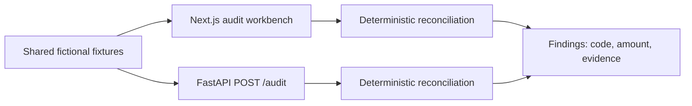

# Architecture

GitHub Pages hosts only the static frontend. FastAPI is tested source, not a live dependency. Production would move normalization/reconciliation behind the API, persist immutable inputs and decision events, and keep marketplace adapters isolated.
